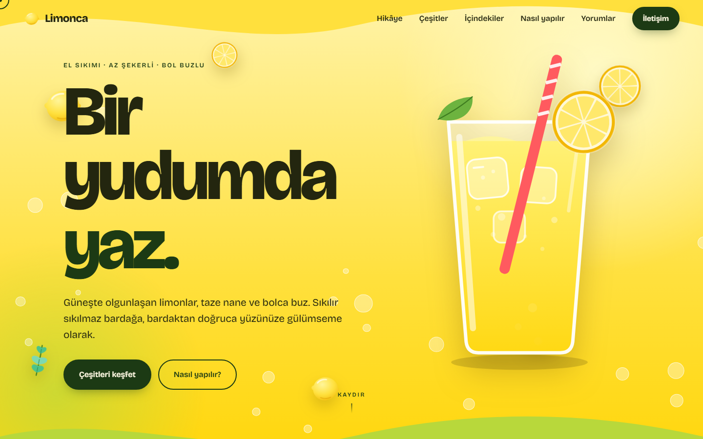
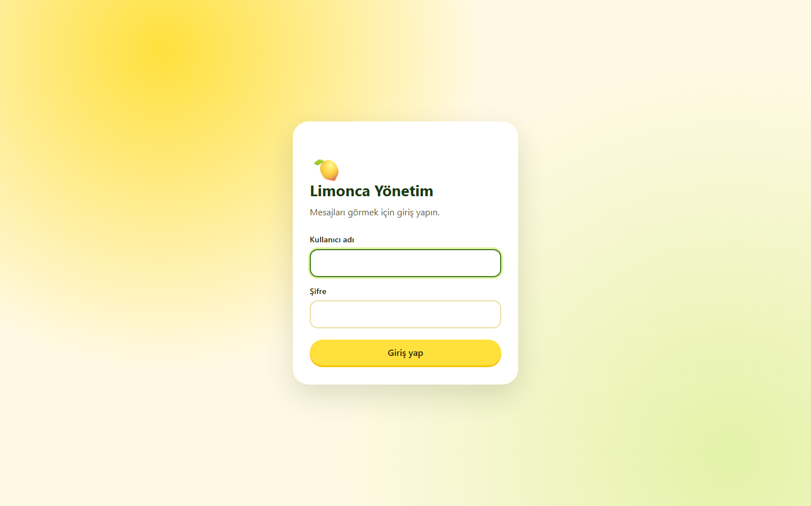

# Limonca — Lemonade Brand Website

An animated, scroll-driven brand website for a fictional lemonade company, with a contact form and a small admin panel to manage incoming messages. All illustrations are drawn in code (inline SVG and CSS), so the project needs no image assets.

<p align="center">
  
</p>

<p align="center">
  
</p>

## Features

- **Scroll-driven animation** — split-text headlines, parallax, floating fruit and bubbles, a marquee, and step-by-step reveals that change as you scroll (GSAP + ScrollTrigger, smooth scrolling with Lenis).
- **Illustrations without images** — the glass, lemons, mint and bubbles are SVG/CSS.
- **Contact form** — validated on the server, rate limited, stored in SQLite.
- **Admin panel** (`/admin/`) — sign in, read messages, change their status, delete them, and see simple statistics.

## Tech stack

| Layer | Technology |
|---|---|
| Front end | Vanilla HTML, CSS and JavaScript, GSAP 3, ScrollTrigger, Lenis (loaded from CDN) |
| Back end | Node.js, Express 4 |
| Database | SQLite via `better-sqlite3` |
| Auth | JSON Web Tokens (`jsonwebtoken`), credentials from environment variables |

## Getting started

Requirements: a current Node.js LTS release (the project was developed on Node 24).

```bash
cd backend
npm install
cp .env.example .env     # then edit the values
npm start
```

Open:

- Site: <http://localhost:3000/>
- Admin panel: <http://localhost:3000/admin/>

### Configuration

Create `backend/.env` from `backend/.env.example`:

| Variable | Description |
|---|---|
| `PORT` | Port to listen on (default `3000`) |
| `ADMIN_KULLANICI` | Admin username |
| `ADMIN_SIFRE` | Admin password — use a strong, unique value |
| `JWT_SECRET` | Long random string used to sign tokens |
| `CORS_ORIGIN` | Optional, comma-separated list of allowed origins (empty allows all) |

The server will not start unless `ADMIN_KULLANICI`, `ADMIN_SIFRE` and `JWT_SECRET` are set. The `.env` file and the SQLite database (`backend/limonata.db`) are created locally and are excluded from version control.

## API

The API is documented in [`SOZLESME.md`](SOZLESME.md) (in Turkish). Summary:

| Method | Endpoint | Access | Purpose |
|---|---|---|---|
| `POST` | `/api/iletisim` | Public | Submit the contact form |
| `POST` | `/api/admin/giris` | Public | Admin sign-in, returns a token |
| `GET` | `/api/admin/mesajlar` | Admin | List messages |
| `PATCH` | `/api/admin/mesajlar/:id` | Admin | Update a message status |
| `DELETE` | `/api/admin/mesajlar/:id` | Admin | Delete a message |
| `GET` | `/api/admin/istatistik` | Admin | Message statistics |

## Project structure

```
backend/        Express server, SQLite storage, admin API
web/            Public site (index.html, css/, js/, assets/)
web/admin/      Admin panel
docs/           README screenshots
SOZLESME.md     API contract
```

## Notes

- The page content is written in Turkish.
- GSAP, ScrollTrigger, Lenis and the Google Font are loaded from public CDNs, so an internet connection is needed for the animations and typography.
- The contact form only stores messages; it does not send e-mail.

## Author

Berkay Özdemir — [GitHub](https://github.com/berkayozdmr21)
